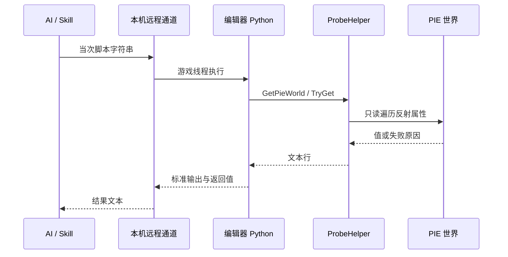

> 把 Unity HotScript「任意时刻执行一段即用即弃、不改主代码」的能力搬到虚幻：第一期用官方 Python 远程执行做只读探针，不换 DLL，不把临时代码焊进玩法。

---

# 1. 背景描述

## 1.1 相关文档

| 文档类型 | 说明 |
|----------|------|
| 策划需求案 | 无。本文是跨引擎工具设计，不对应某一条玩法需求 |
| Unity 侧实现 | `HotScriptMdl`、`sCompile`、`sCompile-HotScript` Skill |
| 虚幻官方能力 | Python Editor Script Plugin 的 Remote Execution；Remote Control 的 `ExecutePythonCommandEx` |

## 1.2 需求背景

HotScript 在 Unity 工程里已经跑通一条 AI 排查链路：编辑器处于 Play 时，AI 改一段临时代码，外部编译器编出独立程序集，按字节加载后调用固定入口 `HotScriptEntry.Eval`，把结果写入 `result.txt`。业务模块的方法表不被替换，临时代码也不进入正式提交流程。

这条链路里，换 DLL 只是 C# 不能直接 `eval` 字符串时的载体。真正要传到虚幻的是下面四条：

1. **任意时刻**：编辑器开着、对局正在跑，就能执行。
2. **任意逻辑**：不限于把属性名打印出来，可以过滤、对照、做一次计算。
3. **即用即弃**：逻辑留在当次调用的字符串里，不进游戏模块，不进玩法脚本。
4. **结果交回 AI**：调用方拿到一段可解析的文本，而不是让人去编辑器里肉眼看。

虚幻编辑器在 Win64 上本来就按模块出 DLL，也有 Live Coding 做函数体热补丁。缺的是「旁路执行一段临时代码、读当前局、然后丢掉」。官方 Python 已经是一个常驻的字符串执行器，第一期应直接用它，而不是再造一套程序集热替换。

## 1.3 技术挑战

| 序号 | 挑战 | 说明 |
|------|------|------|
| 1 | 载体选错会变成改玩法 | Live Coding、旧 Hot Reload、UnLua `HotReload()` 都在改正在跑的代码，和「不干扰主代码」相反 |
| 2 | PIE 世界不是编辑器世界 | Play 之后引擎复制出一份 PIE 世界。读编辑器世界会得到一份没在跑的对象 |
| 3 | 反射墙 | Python 和 Lua 绑定只能看见 `UPROPERTY` / `UFUNCTION`。未反射的 C++ 成员不在本期范围 |
| 4 | 游戏线程 | UE 5.6 起，Python 调虚幻 API 必须在游戏线程上。探针必须短、同步 |
| 5 | 失败要可观测 | 值为空和「属性名写错 / 世界没找到」必须能区分，否则 AI 会把读失败当成业务结论 |
| 6 | 远程执行的安全边界 | 通道只给本机 AI 用。放开到局域网等于允许任意代码进入编辑器进程 |

---

# 2. 整体架构设计

## 2.1 方案选择

| 方案 | 能做的事 | 和本宗旨的关系 | 本期 |
|------|----------|----------------|------|
| 旁路探针 DLL：`LoadLibrary` → `Eval` → `FreeLibrary` | 原生代码读状态，用完可真卸载 | 能力最强，但要自建编译环境（PCH、generated.h、包含路径） | 不作为第一期。留给反射墙挡住的原生状态 |
| Live Coding | 改 `.cpp` 函数体，入口写跳转到 patch | 临时代码会焊进正在跑的函数，编辑器关闭后还要正规编译才能落盘 | 禁止作为探针通道 |
| 旧 Hot Reload（卸模块 DLL 再装） | 整模块换新 DLL，并做 UObject 重建 | 官方已放弃当主流程，游戏模块和编辑器模块容易崩溃或损坏资产 | 不做 |
| Angelscript / UnrealSharp | 用脚本或 C# 写长期玩法，函数体可热更 | 这是另一套玩法运行时，停在同一道反射墙。引入成本远大于一次排查 | 不为本探针引入 |
| UnLua `HotReload()` | 按文件重载玩法模块，尽量保住表和 upvalue | 改的是正在跑的玩法。已有 Lua 时也不走这条 | 禁止作为探针通道 |
| **官方 Python 远程执行** | 把一段字符串送进已打开的编辑器，在游戏线程执行，把打印和返回值送回 | 编辑器不必重启，脚本不落盘，默认可以只读。官方自带，无引擎分叉 | **第一期** |
| 已有 `lua_State` 上 `luaL_dostring` | 读玩法 Lua 表、upvalue；`debug.sethook` 可临时看调用流 | 仅当关键状态住在 Lua 里、反射爬不到时启用。虚拟机必须已经嵌在进程里 | 第二通道，按需 |

选定 Python 的原因：HotScript 的编译和 `Assembly.Load` 是为了绕开「C# 没有字符串执行」。虚幻的 Python 插件本身就是字符串执行器，Remote Execution（组播发现加一条 TCP）或 Remote Control 的 `ExecutePythonCommandEx` 已经把字符串送进进程并带回结果。第一期把工程量花在「找对世界、把结果写成 AI 能读的文本、用 Skill 管住边界」上。

常驻的只有解释器和一个很小的辅助模块。每次排查的逻辑仍由 AI 当场写。

## 2.2 模块职责

| 模块 | 谁提供 | 职责 | 是否进玩法工程 |
|------|--------|------|----------------|
| Python 解释器 | 引擎 PythonScriptPlugin | 执行字符串，保持 `sys.modules` | 否，编辑器插件 |
| 远程执行通道 | Remote Execution，或本机 Remote Control | 发现已打开的编辑器，送入脚本，取回输出 | 否，只绑本机 |
| `ProbeHelper` | 本期新建的一个 Python 模块 | 找 PIE 世界、按类遍历、读属性、把失败写成 `miss` / `error` | 是，仅工具模块，不含具体排查逻辑 |
| 当次脚本 | AI 按 Skill 生成 | 一次具体排查：计算、过滤、对照，调用 `ProbeHelper` | 否，不提交 |
| Skill | 给人读的规范，给 AI 当操作手册 | 规定能写什么、不能写什么、结果长什么样、失败怎么读 | 仓库内的 Skill 文件 |

`ProbeHelper` 对应 Unity 侧常驻的 `HotScriptReflect`：只提供读法，不承载某一次 Bug 的逻辑。当次脚本对应 `HotScriptEntry.Eval` 的方法体。

## 2.3 一次排查的时序



线性步骤是：确认编辑器已开且通道可用 → 发送脚本 → 脚本里先拿 PIE 世界 → 只读查询 → 按结果契约输出 → AI 读文本。上图只标出参与方，避免把这条直线再画成流程图。

---

# 3. 通道与结果契约

## 3.1 设计原则

1. 探针逻辑不进游戏 C++、不进蓝图、不进玩法 Lua。
2. 默认只读。会改对局的调用必须在脚本开头写明意图，Skill 默认不生成这类语句。
3. 一次调用同步返回。不注册 Tick，不挂定时器，不留 `debug.sethook`。
4. 世界必须由 `ProbeHelper` 选择。禁止脚本自己拿「当前编辑器世界」当作正在跑的那一局。
5. 失败写入结果文本。禁止用「值是 None」同时表示「属性不存在」和「属性存在但为空」。
6. 辅助模块只导入一次。当次脚本保持短，具体排查逻辑写在字符串里。

## 3.2 核心接口

| 接口 | 返回 | 行为 |
|------|------|------|
| `GetPieWorld()` | World 或错误文本 | 遍历 `World`，只取 `is_play_in_editor()` 为真的实例。零个或不止一个都返回 `error.world=...`，不猜 |
| `TryGetProperty(obj, names...)` | `(ok, value, error)` | 按候选名读反射属性。一个都没有时 `error` 为 `miss.property=a\|b` |
| `FormatProperty(obj, names...)` | 字符串 | 失败返回 `miss` / `error` 原文；值为空返回 `null` |
| `IterActors(world, class_name)` | 列表或错误 | 只在已选定的 PIE 世界里按类遍历 |
| `CallReflected(obj, func_name, args)` | `(ok, value, error)` | 只调用已反射函数。默认 Skill 不使用它做写入 |

候选名和 `miss.property=` 的写法对齐 `HotScriptReflect`：AI 看到 `miss` 就改名字再探一次，看到 `null` 才把「当前就是空」写进结论。

## 3.3 结果契约

当次脚本把结论打到标准输出，远程通道原样返回。建议固定这些行，方便 Skill 和人同时读：

```text
ok=true|false
world=pie
error.world=none_or_reason
subject=<类名或对象路径>
<key>=<value>
miss.property=<候选名>
```

`ok=false` 时必须有一条 `error.*` 或 `miss.*`。没有这两类行时，Skill 要求 AI 把这次执行当成通道失败，而不是业务结论。

## 3.4 实现要点

- Remote Execution 走 Python 插件的官方协议：组播发现编辑器节点，再开一条 TCP 执行。多开编辑器时用返回的节点区分，禁止连错实例。
- 另一条可用入口是本机 Remote Control 的 `ExecutePythonCommandEx`。它听 `127.0.0.1`。配置写在 `Config/DefaultRemoteControl.ini`（`URemoteControlSettings` 的 config 名是 RemoteControl），写进 `DefaultEngine.ini` 不会生效。两条开关要同时开：允许远程执行 Python，以及把 `PythonScriptLibrary` 放进允许调用的函数列表。
- `ExecuteFile` 跑多行脚本；`EvaluateStatement` 只适合回传一个表达式。排查脚本一律用 `ExecuteFile`。
- UE 5.6 及以后，绑定调用带游戏线程检查。通道实现要把执行封到游戏线程，不能放进后台 Python 线程。
- `sys.modules` 跨调用保留。`ProbeHelper` 以固定模块名导入；源码变化时用内容哈希判断要不要重新加载。编辑器重启后第一次调用会发现模块不在，再装一次。

---

# 4. 落地路径

按下面的顺序做。前一步没有真实读到 PIE 里的对象，不开始下一步。

| 阶段 | 交付 | 完成标准 |
|------|------|----------|
| 0. 通道 | 打开 Python 插件和本机远程执行，编辑器保持运行 | 从进程外送入一段打印脚本，能拿回输出。PIE 未启动时 `GetPieWorld` 返回 `error.world`，而不是崩溃 |
| 1. 辅助模块 | `ProbeHelper`：找世界、遍历、`TryGetProperty`、结果行 | 手写一段脚本，读到一个正在 PIE 里的 Actor 的反射属性；故意写错属性名时输出 `miss.property=` |
| 2. Skill | 按第 5 节写成 AI 可执行的 Skill | 换一个没有参与编写的人，只把 Skill 交给 AI，能独立完成一次只读排查并交回结果文本 |
| 3. 试点 | 选一个真实对局问题（状态机、生成物数量、某个组件是否存在） | AI 的结论能用日志或断点对上。错了就改 Skill 里的误用对照，不改玩法代码来「配合探针」 |
| 4. 调试门面 | 仅当试点被反射墙挡住 | 在对应模块加一个只读的反射函数，把需要的原生数据抄出来。Python 只调用这个函数，仍不直接摸私有字段 |
| 5. 第二通道 | 仅当状态住在 Lua 表里 | 在已有 `lua_State` 上加 `Probe.Eval`，`pcall` 一段字符串。不调用 `UnLua.HotReload()` |

阶段 4 的门面是正式代码，要走评审，而且只暴露排查需要的只读数据。阶段 5 的 `debug.sethook` 若要用，必须写在 `pcall` 的清理路径里卸掉；留下的 hook 会拖慢之后每一段 Lua。

项目里没有 Lua 时，不为本探针接入 UnLua。那是引进一整套玩法运行时。

---

# 5. Skill 化书写思路

Skill 是给 AI 的操作手册，不是第二份设计案。写法对齐现有 `sCompile-HotScript`：短、硬、失败可观测。AI 没读 Skill 就不许发送脚本。

## 5.1 文档骨架

| 章节 | 写什么 |
|------|--------|
| 用途 | 一句话：在已打开的编辑器里执行一段只读脚本，读当前 PIE，把文本交回来 |
| 铁律 | 下面 5.2 的禁令，放在全文最前 |
| 调用 | 通道怎么开、多开时怎么选节点、用 `ExecuteFile`、超时多少秒 |
| 辅助 API | 第 3.2 节的表，附「失败时 error 长什么样」 |
| 结果契约 | 第 3.3 节的行格式。要求 AI 先读 `ok` / `miss` / `error`，再解释业务 |
| 最小示例 | 两则就够：读到一个对象；属性名错误时看到 `miss.property` |
| 误用对照 | 选错世界、把 None 当缺失、脚本写进玩法资源、用 Live Coding 或 HotReload 代替本通道 |

## 5.2 建议写进 Skill 的铁律

1. 唯一允许 AI 产生的代码是当次脚本字符串。禁止改游戏 C++、蓝图、玩法 Lua、配置和资源。
2. 禁止触发 Live Coding、模块重编译、编辑器重启、资产保存。
3. 世界只能来自 `ProbeHelper.GetPieWorld()`。
4. 读属性只用 `TryGetProperty` / `FormatProperty`。禁止用「值是 None」判断成员不存在。
5. 默认只读。脚本里出现生成、销毁、改属性、发 RPC，视为越界，不发送。
6. 一次一问。脚本只回答当前排查，不顺手修 Bug。
7. 通道没返回 `ok=` 行，就汇报通道失败，不编造对局状态。

## 5.3 和 Unity HotScript Skill 的对应

| Unity Skill 里的约束 | 虚幻 Skill 里的对应 |
|----------------------|---------------------|
| 只能改 `HotScriptMdl/Scripts/` | 只能产生当次脚本字符串 |
| 不 Refresh、不触发域重载 | 不 Live Coding、不重编模块、不重启编辑器 |
| 跨模块只用 `HotScriptReflect`，miss 要写入结果 | 只用 `ProbeHelper`，`miss.property` / `error.world` 写入结果 |
| 固定入口 `Eval(outDirPath)`，读 `result.txt` | 固定走远程 `ExecuteFile`，读返回文本 |
| 默认 dump，不改对局 | 默认只读，不改 PIE |

Unity 那份 Skill 里「编译路径是 sCompile」的整节不要搬。虚幻这里没有外部 csc，也不存在 `HotScriptEval` 这种编译工具。

## 5.4 一则最小脚本的形状

下面是契约示例，落地时以 `ProbeHelper` 的真实函数名为准。

```python
import ProbeHelper

world, err = ProbeHelper.GetPieWorld()
if err:
    print("ok=false")
    print(err)
else:
    actors, err = ProbeHelper.IterActors(world, "目标类名")
    print("ok=true" if not err else "ok=false")
    print("world=pie")
    if err:
        print(err)
    elif not actors:
        print("count=0")
    else:
        print("count=" + str(len(actors)))
        print(ProbeHelper.FormatProperty(actors[0], "属性候选A", "属性候选B"))
```

Skill 里保留这一则即可。具体类名和属性名由当次排查填写，不写进 Skill 本体。

---

# 6. 意义和应用前景

排查方式从「读代码猜测这一局的状态」变成「问正在跑的这一局」。程序、策划和 AI 共用同一条只读通道，结论可以对照，而不是各自看一份日志。

临时代码留在通道里，不会通过 Live Coding 进函数入口，也不会通过热重载进玩法脚本。对局结束后进程里不留下这次排查的逻辑。

这套做法能迁到别的引擎。可迁移的是三件事：一个字符串执行器、一道明确的反射边界、一份失败可区分的结果文本。不可迁移的是某一种热替换 DLL 的技术。Unity 因为语言限制用了程序集；虚幻第一期用 Python。两边的 Skill 结构可以相同。

适合的场景：

- 对局中确认某个 Actor、组件、状态机当前值。
- 生成物数量、归属、是否已销毁这一类「代码看起来会、运行时未必」的问题。
- AI 修 Bug 之前先取证。取证脚本不进入修复用的提交。
- 给新同学一个固定读法，减少每个人自己在编辑器里点一遍细节面板。

不适合的场景：未反射的原生内存、需要跨很多帧采样的性能问题、以及任何要改对局才能验证的修复。后两类仍走日志、Insights 或正常的代码修改流程。

---

# 7. 未来方向

| 方向 | 触发条件 | 做法 |
|------|----------|------|
| 调试门面 | 同一种原生状态被反复问到，且反射看不见 | 模块提供一个只读反射函数，探针只调函数 |
| Lua `Probe.Eval` | 玩法数据在 Lua 表里 | 共用已有虚拟机做 `dostring`。观察调用流时用 `debug.sethook`，结束必卸 |
| 旁路探针 DLL | 门面不够用，且问题只存在于原生布局 | 普通 C++、不跑 UHT、时间戳 DLL、`LoadLibrary` / `FreeLibrary`。仍不替换业务模块 |
| 结果结构化 | 文本行开始不够表达多层对象 | 在现有行契约之上增加一份 JSON，行契约保留，方便人和旧 Skill 阅读 |
| 和日志、崩溃联动 | 一次排查需要同时看状态和日志 | Skill 允许先取探针结果，再按时间去对日志。探针本身不负责拉日志 |

旁路 DLL 如果做，边界和第一期相同：不注册 `UCLASS`、不挂委托、不在返回后还留线程在探针里。它解决的是反射墙，不替代 Python 通道。

---

# 8. 风险点分析

## 8.1 技术风险

| 风险点 | 等级 | 影响 | 应对措施 |
|--------|------|------|----------|
| 读到编辑器世界 | 高 | 结论与正在跑的对局无关 | `GetPieWorld()` 独占世界选择；零个或复数世界直接 `error.world` |
| 把空值当成属性缺失 | 高 | AI 写出错误根因 | `miss.property` 与 `null` 分列；Skill 禁止用 None 判断缺失 |
| 反射墙 | 高 | 原生私有状态读不到 | 本期明确写进结果 `error.unreflected`；重复出现再开门面，不假装能反射 |
| 脚本改了 PIE | 中 | 排查本身破坏现场 | Skill 默认只读；通道侧可先做约定，后续再考虑只读包装 |
| 游戏线程被长脚本堵住 | 中 | 编辑器卡住 | 超时；禁止在脚本里遍历全量无过滤对象；不注册 Tick |
| 远程执行被误开放 | 中 | 非本机也能执行任意 Python | 只绑回环地址；不开启「允许任意远程函数」；Skill 不包含把端口暴露到局域网的步骤 |
| 连错编辑器实例 | 中 | 读到另一个工程的局 | 发现协议返回的节点要核对工程路径后再执行 |
| 用热更通道「顺便」改代码 | 中 | 主代码被探针污染 | Skill 铁律禁止 Live Coding 和 `UnLua.HotReload()` |
| UE 版本差异 | 低 | 5.6 前后线程约束不同 | Skill 写明 5.6 起必须游戏线程；通道实现做封送，而不是要求 AI 处理线程 |

## 8.2 降级方案

远程通道不可用时，同一段脚本可以贴进编辑器输出日志的 `py` 命令执行。结果仍按第 3.3 节的行格式阅读。降级只影响「谁把字符串送进去」，不改变世界选择和只读约束。

Python 插件在目标引擎版本被裁掉时，本期不做。不回退到 Live Coding，也不为了探针单独接一套 Angelscript 或 UnrealSharp。
